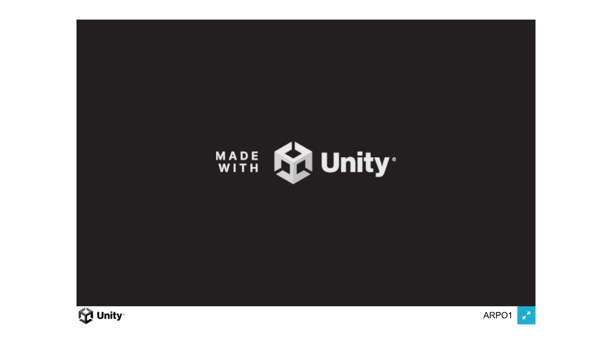
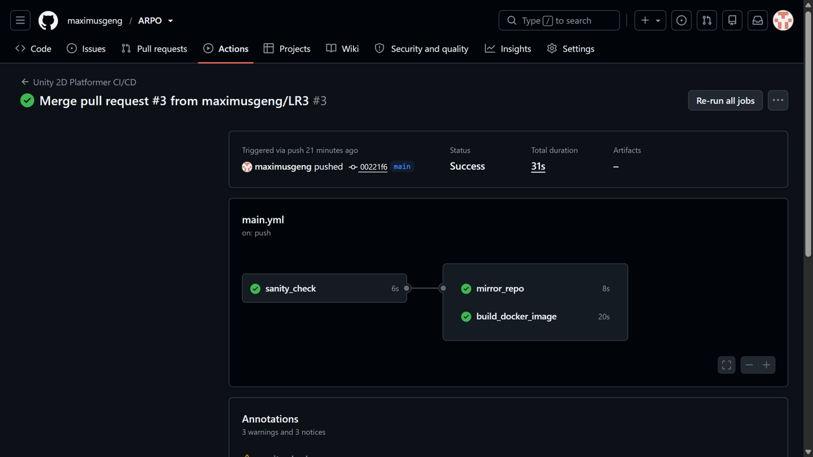
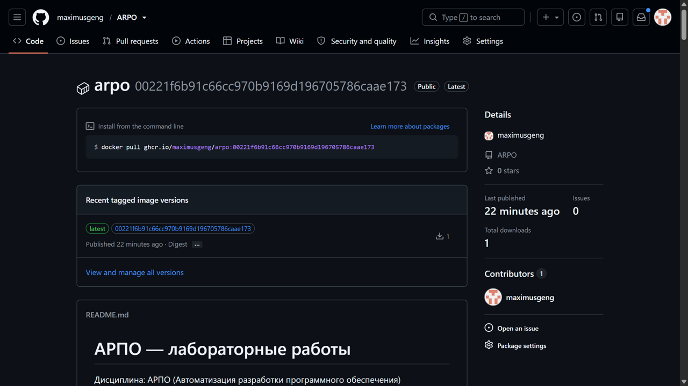
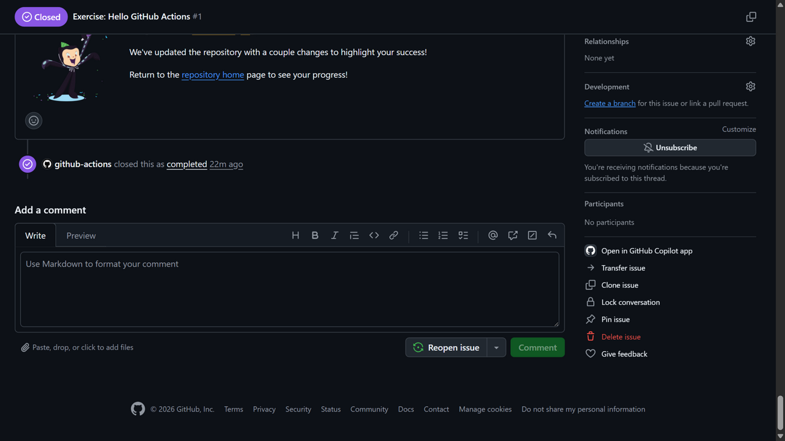
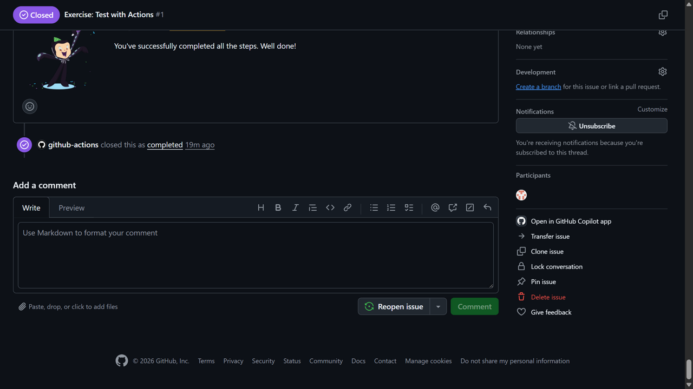
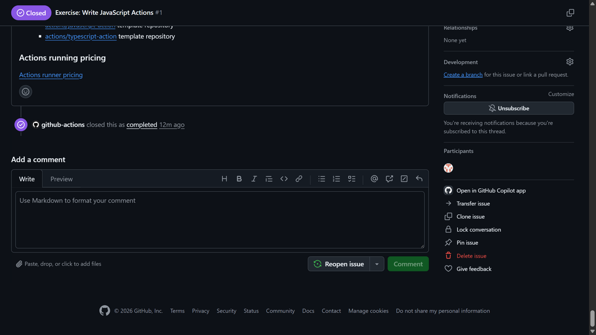

# Лабораторная работа №3. Контейнеризация веб-сервера в Docker и раздача сжатых файлов со стороны Nginx

**Цель:** собрать WebGL-версию игры в формате Gzip, настроить Nginx так, чтобы он
отдавал сжатые архивы с корректным заголовком `Content-Encoding: gzip`, упаковать
веб-сервер вместе с игрой в Docker-образ и автоматизировать сборку и публикацию
этого образа в GitHub Container Registry (GHCR) через GitHub Actions.

## Что сделано

| Артефакт | Назначение |
|---|---|
| `ProjectSettings/ProjectSettings.asset` | WebGL: `Compression Format = Gzip`, `Decompression Fallback = off` |
| `Builds/WebGL/Build/*.gz` | Пересобранная игра со сжатыми архивами |
| `nginx.conf` | Кастомная конфигурация веб-сервера с заголовками `Content-Encoding: gzip` |
| `Dockerfile` | Образ `nginx:alpine` + конфиг + сжатая игра |
| `.github/workflows/main.yml` | Новое задание `build_docker_image` — сборка и пуш образа в GHCR |

---

## Шаг 1. Gzip-сжатие WebGL в Unity 6 и пересборка

В `Player Settings → Player → WebGL → Publishing Settings` установлено:

- **Compression Format** = `Gzip`;
- **Decompression Fallback** = выключено.

В `ProjectSettings/ProjectSettings.asset` это соответствует строкам
`webGLCompressionFormat: 1` (Gzip) и `webGLDecompressionFallback: 0`.

Пересборка выполнена из терминала командой из ЛР №1:

```powershell
& "C:\Program Files\Unity\Hub\Editor\6000.6.0f1\Editor\Unity.exe" -batchmode -nographics -projectPath . -executeMethod BuildManager.BuildWebGL -quit -logFile build_webgl.log
```

Результат — папка `Builds/WebGL/Build/` с **сжатыми** файлами:

```text
Builds/WebGL/Build/WebGL.data.gz          (8 659 620 байт)
Builds/WebGL/Build/WebGL.framework.js.gz  (    83 654 байт)
Builds/WebGL/Build/WebGL.loader.js
Builds/WebGL/Build/WebGL.wasm.gz          (10 640 485 байт)
```

Строки из `build_webgl.log`:

```text
[LR3] compressionFormat=Gzip (Gzip=1), decompressionFallback=False
[CI/CD] УСПЕХ! WebGL билд успешно создан.
[CI/CD] Время сборки: 53,76 сек. Размер: 19431914 байт.
```

## Шаг 2. Конфигурация веб-сервера `nginx.conf`

```nginx
server {
    listen 80;
    server_name localhost;

    location / {
        root /usr/share/nginx/html;
        index index.html;
        try_files $uri $uri/ /index.html;

        # Правила для перехвата JavaScript-архивов Unity
        location ~* \.js\.gz$ {
            add_header Content-Encoding gzip;
            default_type application/javascript;
        }

        # Правила для перехвата бинарного кода WebAssembly
        location ~* \.wasm\.gz$ {
            add_header Content-Encoding gzip;
            default_type application/wasm;
        }

        # Правила для перехвата текстур и ресурсов игры
        location ~* \.data\.gz$ {
            add_header Content-Encoding gzip;
            default_type application/octet-stream;
        }
    }
}
```

## Шаг 3. `Dockerfile` с подменой слоёв

```dockerfile
# Шаг 1: Берем официальный ультра-легкий веб-сервер Nginx на базе Alpine Linux
FROM nginx:alpine

# Шаг 2: Удаляем дефолтный файл настроек Nginx, блокирующий работу архивов
RUN rm /etc/nginx/conf.d/default.conf

# Шаг 3: Копируем наш кастомный nginx.conf внутрь системных папок сервера
COPY nginx.conf /etc/nginx/conf.d/

# Шаг 4: Очищаем стандартную веб-папку и копируем туда файлы сжатой игры из ЛР №1
RUN rm -rf /usr/share/nginx/html/*
COPY Builds/WebGL/ /usr/share/nginx/html/

# Шаг 5: Объявляем рабочий порт контейнера
EXPOSE 80

# Шаг 6: Запускаем Nginx в режиме постоянного процесса (демона)
CMD ["nginx", "-g", "daemon off;"]
```

## Шаг 4. Локальная проверка раздачи сжатых файлов

Команды из методички (выполняются там, где установлен Docker):

```bash
docker build -t platformer-compressed:v1 .
docker run -d -p 8080:80 --name unity_compressed_container platformer-compressed:v1
# ... проверка в браузере на http://localhost:8080 ...
docker stop unity_compressed_container && docker rm unity_compressed_container
```

> **Примечание.** На машине, где выполнялась работа, Docker не установлен, поэтому
> контейнер локально не запускался. Вместо этого тот же `nginx.conf` был запущен
> локальным веб-сервером Nginx, раздающим ту же самую папку `Builds/WebGL`, — это
> позволяет проверить главное: отдачу заголовка `Content-Encoding: gzip`.
> Сам Docker-образ собран и опубликован в облаке (шаг 5), что подтверждается
> логом GitHub Actions и страницей пакета.

Проверка фактических заголовков ответа (`curl -I`):

```text
HTTP/1.1 200 OK
Content-Type: application/wasm
Content-Encoding: gzip        <-- /Build/WebGL.wasm.gz

HTTP/1.1 200 OK
Content-Type: application/octet-stream
Content-Encoding: gzip        <-- /Build/WebGL.data.gz

HTTP/1.1 200 OK
Content-Type: application/javascript
Content-Encoding: gzip        <-- /Build/WebGL.framework.js.gz
```

Игра успешно загружается с локального сервера:



Полный вывод заголовков сохранён в [`docs/lr3/local-gzip-headers.txt`](docs/lr3/local-gzip-headers.txt).

## Шаг 5. Модернизация пайплайна GitHub Actions (GHCR)

В `.github/workflows/main.yml` добавлено третье задание `build_docker_image`.
Так как папка `Builds/` исключена `.gitignore` и в облако не попадает, пайплайн
перед сборкой образа создаёт временные файлы-заглушки с расширением `.gz` —
иначе шаг `COPY Builds/WebGL/ ...` в `Dockerfile` упал бы.

```yaml
  # НОВЫЙ ЭТАП 3: Автоматическая сборка Docker-образа в облако
  build_docker_image:
    needs: sanity_check
    runs-on: ubuntu-latest

    # КРИТИЧЕСКИ ВАЖНЫЕ СТРОКИ: Разрешаем этой конкретной задаче публиковать пакеты
    permissions:
      contents: read
      packages: write

    steps:
      - name: Checkout code
        uses: actions/checkout@v4

      - name: Create Compressed Placeholders for Docker
        # Генерируем фейковые .gz файлы, чтобы шаг COPY в Dockerfile не упал без реального билда
        run: |
          mkdir -p Builds/WebGL/Build
          if [ -z "$(ls -A Builds/WebGL/Build)" ]; then
            echo "<h3>Unity 6 Compressed Game Cloud Layer</h3>" > Builds/WebGL/index.html
            touch Builds/WebGL/Build/game.framework.js.gz
            touch Builds/WebGL/Build/game.wasm.gz
            touch Builds/WebGL/Build/game.data.gz
            echo "Создана временная структура сжатых файлов для сборщика Docker."
          fi

      - name: Log in to GitHub Container Registry
        uses: docker/login-action@v3
        with:
          registry: ghcr.io
          username: ${{ github.actor }}
          password: ${{ secrets.GITHUB_TOKEN }} # Системный автоматический токен GitHub

      - name: Build and Push Compressed Docker Image
        uses: docker/build-push-action@v5
        with:
          context: .
          file: ./Dockerfile
          push: true
          tags: |
            ghcr.io/maximusgeng/arpo:latest
            ghcr.io/maximusgeng/arpo:${{ github.sha }}
```

Значения `nbrouka/platformer-game` из методички заменены на `maximusgeng/arpo`
(в GHCR имя обязано быть в нижнем регистре).

## Шаг 6. Отправка изменений

`nginx.conf`, `Dockerfile` и обновлённый пайплайн добавлены в ветку `LR3`, оформлен
Pull Request [#3](https://github.com/maximusgeng/ARPO/pull/3) и слит в `main` —
это запустило пайплайн.

## Шаг 7. Результаты

### Все три задачи пайплайна — зелёные

`Push в main` запустил все три задания: `sanity_check` (6 s), `mirror_repo` (8 s)
и `build_docker_image` (20 s) — статус **Success**.



### Готовый пакет в GitHub Container Registry

Образ собран и опубликован: теги `ghcr.io/maximusgeng/arpo:latest` и
`ghcr.io/maximusgeng/arpo:00221f6b91c66cc970b9169d196705786caae173`.

Страница пакета: <https://github.com/maximusgeng/ARPO/pkgs/container/arpo>



### Файлы в репозитории

`Dockerfile`, `nginx.conf` и обновлённый `.github/workflows/main.yml` находятся
в основном репозитории в ветке `main`.

## Ответы на контрольные вопросы

1. **Какую техническую проблему решает `add_header Content-Encoding gzip;`?**
   Файлы на диске уже сжаты gzip (Unity сохраняет их с расширением `.gz`), но
   браузер по умолчанию ждёт обычные `.js` / `.wasm` / `.data`. Строка
   `add_header Content-Encoding gzip;` сообщает браузеру, что тело ответа
   сжато, и он прозрачно распаковывает его перед использованием. Без этого
   заголовка браузер попытается интерпретировать gzip-байты как исполняемый код
   и выдаст ошибку вида «Unable to parse...». Nginx по умолчанию не умеет
   обрабатывать «двойные» расширения `.wasm.gz` и не выставляет этот заголовок,
   поэтому его задают вручную (вместе с правильным `default_type`).

2. **Почему в облачном пайплайне пришлось генерировать файлы через `touch Builds/WebGL/Build/game.wasm.gz`?**
   Папка `Builds/` исключена `.gitignore`, поэтому в облако она не попадает и на
   раннере файлов игры нет. Без них инструкция `COPY Builds/WebGL/ /usr/share/nginx/html/`
   в `Dockerfile` завершилась бы ошибкой сборки. Временные заглушки нужных
   `.gz`-файлов позволяют образу успешно собраться; реальный Unity-компилятор
   в облаке планируется подключить в ЛР №4.

3. **В какую директорию внутри контейнера Nginx копировать финальные файлы игры?**
   В `/usr/share/nginx/html` — это корневая папка раздачи статики образа `nginx`.

---

# Задание к ЛР№3: курсы GitHub Skills

В рамках задания пройдены три интерактивных курса платформы GitHub Skills,
посвящённых GitHub Actions.

## 1. Hello GitHub Actions

Курс: <https://github.com/skills/hello-github-actions>

Репозиторий: <https://github.com/maximusgeng/skills-hello-github-actions>

Создан первый workflow: ветка `welcome-workflow`, файл `.github/workflows/welcome.yml`
с триггером `pull_request: [opened]`, задачей `welcome` и шагом, который через
GitHub CLI публикует приветственный комментарий в новом Pull Request. Workflow
проверен в действии (комментарий появился в PR), после чего PR слит в `main`.



## 2. Test with Actions

Курс: <https://github.com/skills/test-with-actions>

Репозиторий: <https://github.com/maximusgeng/skills-test-with-actions>

Настроена автоматизация тестирования Python-приложения: добавлены workflow
`python-package.yml` (запуск `pytest`) и `python-coverage.yml` (проверка покрытия
и отчёт в Pull Request). Затем включён branch ruleset **Protect main** с
обязательной проверкой `python-coverage`, из-за чего «сломанный» тест
заблокировал слияние. Тест исправлен (10-е число Фибоначчи — `55`, а не `89`),
проверки стали зелёными, Pull Request слит.



## 3. Write JavaScript Actions

Курс: <https://github.com/skills/write-javascript-actions>

Репозиторий: <https://github.com/maximusgeng/skills-write-javascript-actions>

Написан собственный JavaScript-экшен «Dad Jokes»: инициализирован npm-проект,
созданы исходники (`src/joke.js`, `src/main.js`), бандл собран через `@vercel/ncc`
в `dist/index.js`, оформлены метаданные `action.yml` и workflow
`.github/workflows/joke-action.yml`, который запускается по комментарию `issue_comment`
и выводит случайную шутку. Экшен протестирован комментарием `/joke` в issue.

